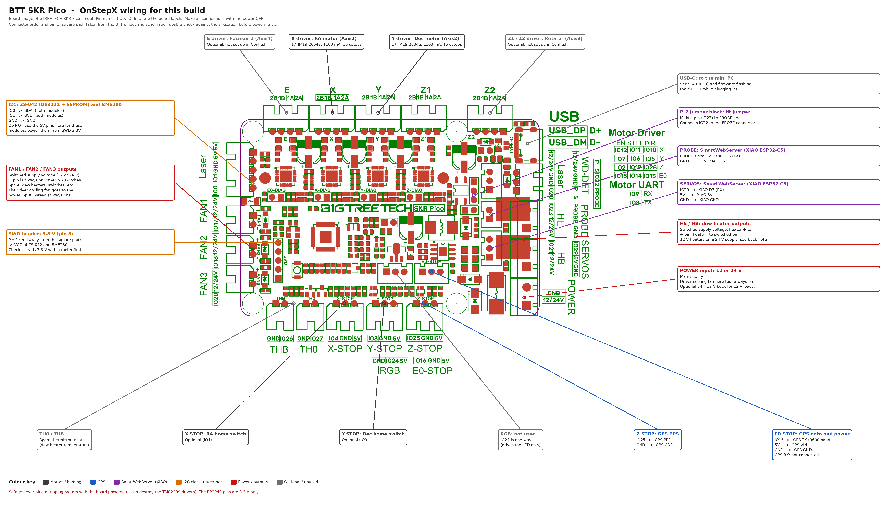

# Onstep X Pico

Combined repository containing:

- `OnStepX/` — telescope mount controller firmware, copied from [hjd1964/OnStepX](https://github.com/hjd1964/OnStepX) (commit b0f18a2)
- `SmartWebServer/` — WiFi/web interface for OnStep, copied from [hjd1964/SmartWebServer](https://github.com/hjd1964/SmartWebServer) (commit 9a65d35)

Both projects are licensed under the GPL-3.0; see the LICENSE file in each folder.

## BTT SKR Pico support

OnStepX has been adapted to run on the [BigTreeTech SKR Pico v1.0](https://github.com/bigtreetech/skr-pico) (RP2040):

- New pinmap `BTT_SKR_PICO` (`OnStepX/src/pinmaps/Pins.SKR_PICO.h`), selected in `OnStepX/Config.h`.
- Hardware step timers for the RP2040 (`OnStepX/src/lib/tasks/HAL_RP2040_HWTIMER.h`). Without these the motors don't step.
- Settings are saved to the Pico's flash, because the board has no EEPROM. You can still pick an external I2C EEPROM with `NV_DRIVER`.
- `Config.h` is preset for the onboard TMC2209 drivers on Axis1/Axis2 at 16 microsteps. Set `AXIS1/2_STEPS_PER_DEGREE`, `AXIS1/2_DRIVER_IRUN` and the rest to suit your mount and motors.

### Board connections

| Board connector | OnStepX use |
|---|---|
| X driver | Axis1 (RA/Azm), TMC2209 UART address 0 |
| Y driver | Axis2 (Dec/Alt), TMC2209 UART address 2 |
| Z driver (Z1/Z2) | Axis3 (rotator), TMC2209 UART address 1 |
| E driver | Axis4 (focuser 1), TMC2209 UART address 3 |
| X-STOP (GPIO4) / Y-STOP (GPIO3) | Axis1 / Axis2 home switch |
| Z-STOP (GPIO25) | GPS PPS input |
| E0-STOP (GPIO16) | GPS serial (receive only, PIO serial port, 9600 baud) |
| PROBE (GPIO22, P_2/PROBE jumper fitted) + SERVOS (GPIO29) | Serial B for the SmartWebServer (PIO serial port): GPIO22 = Pico RX, GPIO29 = Pico TX |
| 5V_Power header: TXD0 (GPIO0 = SDA), RXD0 (GPIO1 = SCL) | I2C (BME280, DS3231 + AT24C32 EEPROM) |
| HE / HB / FAN1 / FAN2 / FAN3 | AUX1..AUX5 MOSFET outputs (dew heaters, switches) |
| TH0 (GPIO27) / THB (GPIO26) | Thermistor inputs for features 1 and 2 |
| USB-C | Serial A |

### Wiring diagram and checklist

The diagram is BIGTREETECH's SKR Pico pinout (from [bigtreetech/skr-pico](https://github.com/bigtreetech/skr-pico)) with this build's connections added. Every wire, connector by connector:

| SKR Pico connector | Pin | Wire to |
|---|---|---|
| X driver | 2B 1B 1A 2A | RA motor (Axis1), 17HM19-2004S |
| Y driver | 2B 1B 1A 2A | Dec motor (Axis2), 17HM19-2004S |
| Z1 / Z2 driver | 2B 1B 1A 2A | Rotator (Axis3), optional, not enabled in `Config.h` |
| E driver | 2B 1B 1A 2A | Focuser 1 (Axis4), optional, not enabled in `Config.h` |
| X-STOP | IO4 / GND | RA home switch, optional |
| Y-STOP | IO3 / GND | Dec home switch, optional |
| E0-STOP | IO16 | GPS TX (9600 baud) |
| E0-STOP | 5V | GPS VIN |
| E0-STOP | GND | GPS GND |
| Z-STOP | IO25 | GPS PPS |
| Z-STOP | GND | GPS GND (optional second ground) |
| P_2 jumper block (P_S / IO22 / PROBE) | | Jumper from the middle pin (IO22) to the PROBE end |
| PROBE | signal | XIAO ESP32-C5 D6 (TX) |
| PROBE | GND | XIAO GND |
| SERVOS | IO29 | XIAO ESP32-C5 D7 (RX) |
| SERVOS | 5V | XIAO 5V |
| SERVOS | GND | XIAO GND |
| IO0/IO1 header (labeled Laser on BTT's pinout, 5V_Power on the schematic) | IO0 | SDA of the ZS-042 and the BME280 |
| IO0/IO1 header | IO1 | SCL of the ZS-042 and the BME280 |
| IO0/IO1 header | GND | GND of the ZS-042 and the BME280 |
| SWD header | pin 5 (3.3V) | VCC of the ZS-042 and the BME280 (not 5V) |
| HE / HB | + / switched | Dew heaters (switched supply voltage) |
| FAN1 / FAN2 / FAN3 | + / switched | Spare switched outputs (supply voltage) |
| TH0 / THB | IO27 / IO26 | Spare thermistor inputs |
| RGB | IO24 | Not used (one way buffer to the LED) |
| POWER | 12/24V / GND | Main supply, plus the always-on driver cooling fan |
| USB-C | | Mini PC (Serial A, firmware flashing) |

Before connecting, check these two with a multimeter. Both were worked out from the square (pin 1) pads:

1. SWD pin 5, at the end away from the square pad, reads 3.3V to GND with the board on USB and nothing else connected.
2. With the P_2 jumper fitted and the power off, there's continuity between the PROBE connector's signal pin and the jumper block's middle pin.

Make every connection with the power off. Plugging or unplugging motors while the board is powered can destroy the TMC2209 drivers.

### Building and flashing OnStepX

Prebuilt files for both boards are in [`firmware/`](firmware/), with flashing steps. To change settings, build from source:

1. Install the [Arduino-Pico core](https://github.com/earlephilhower/arduino-pico) (Earle Philhower). Board manager URL: `https://github.com/earlephilhower/arduino-pico/releases/download/global/package_rp2040_index.json`
2. Install the libraries: [hjd1964/TMC2209](https://github.com/hjd1964/TMC2209) (from GitHub, as a zip), "Adafruit BME280 Library", "RTC by Makuna" and "TinyGPSPlus".
3. Open `OnStepX/OnStepX.ino` and select the board **Raspberry Pi Pico**.
4. Hold the board's BOOT button while plugging in USB, then upload (or copy the `.uf2` onto the drive that appears).

### GPS, clock, weather sensor and EEPROM

`Config.h` is set up for a GPS at 9600 baud with a PPS output (an ATGM336H board, for instance), a ZS-042 DS3231 module (which includes an AT24C32 EEPROM) and a BME280:

- `TIME_LOCATION_SOURCE GPS`, with `TIME_LOCATION_SOURCE_FALLBACK DS3231` so the time is right at power-on before the GPS has a fix
- `TIME_LOCATION_PPS_SENSE HIGH` and `TIME_LOCATION_PPS_SYNC ON`, so the GPS pulse keeps the sidereal clock accurate
- `WEATHER BME280`, at I2C address 0x77 (Adafruit). Many generic purple modules use 0x76; for those, use `BME280_0x76`
- `NV_DRIVER NV_AT24C32`, so settings go to the ZS-042's EEPROM (I2C address 0x57) instead of the Pico's flash

| Device pin | SKR Pico |
|---|---|
| GPS VIN / GND | 5V / GND on the E0-STOP connector |
| GPS TX | E0-STOP signal pin (GPIO16) |
| GPS PPS | Z-STOP signal pin (GPIO25) |
| GPS RX | not connected |
| ZS-042 and BME280 VCC / GND | **3.3V** (SWD header pin 5) / GND |
| ZS-042 and BME280 SDA | TXD0 on the 5V_Power header (GPIO0) |
| ZS-042 and BME280 SCL | RXD0 on the 5V_Power header (GPIO1) |

The Pico's pins don't tolerate 5V, and the ZS-042 pulls SDA/SCL up to its own supply, so power the I2C modules from 3.3V, not the 5V on those headers. The ZS-042 also has a battery charging circuit meant for a rechargeable LIR2032. With a regular CR2032, remove the charging resistor (or its diode) so the battery isn't charged.

The GPS has to stay at 9600 baud: the E0-STOP input has a small RC filter (100R and 0.1uF) that is fine at that rate but too slow for faster ones. A u-blox board (38400 baud by default) needs its baud rate set to 9600 once, with u-center for instance, and `SERIAL_GPS_BAUD` left at its default.

There are no free inputs for a PEC index or limit switch. To use one, add `#define PEC_SENSE_PIN 3` or `#define LIMIT_SENSE_PIN 3` (Y-STOP, if not used for homing) or similar to `Config.h`.

The RGB connector (GPIO24) can't be used for I2C or other inputs: it goes through a one way 5V buffer to drive the RGB LED.

### SmartWebServer

The SmartWebServer runs on a Seeed Studio XIAO ESP32-C5, with a pinmap in `SmartWebServer/src/pinmaps/Pins.XiaoEsp32c5.h`. In the Arduino IDE, use the Espressif ESP32 package (3.3 or newer) and select the board **XIAO_ESP32C5**. Out of the box it starts its own Wi-Fi network, "OnStep-SWS" (password `password`), with the web interface at http://192.168.0.1. From there you can join it to your home network, or change the defaults in `SmartWebServer/Extended.config.h` before flashing.

| XIAO ESP32-C5 | SKR Pico |
|---|---|
| D6 (TX, GPIO11) | PROBE signal pin (GPIO22), with the P_2/PROBE jumper fitted |
| D7 (RX, GPIO12) | SERVOS signal pin (GPIO29) |
| 5V | 5V on the SERVOS or 5V_Power connector |
| GND | GND |
